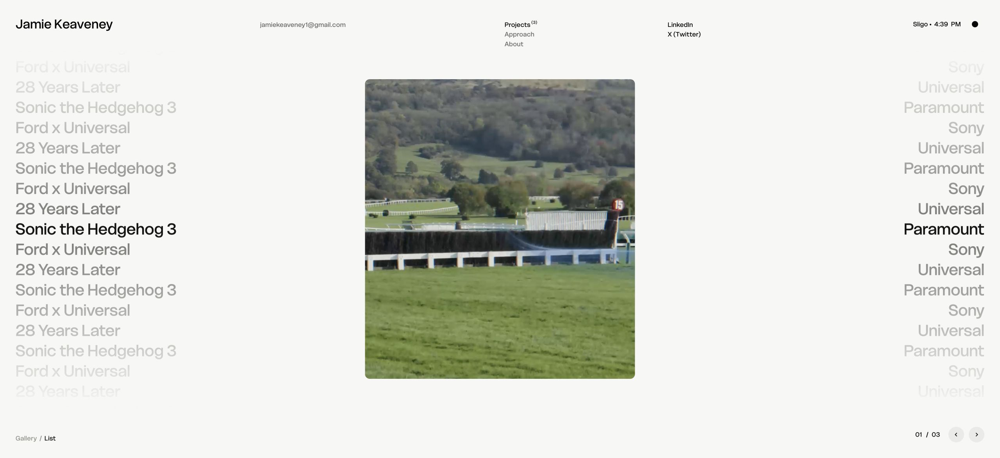

# Release validation — v1.2.5 / R16

Checked on 19 November 2026 against Webflow staging. Runtime revision: `236fd01db403bfc0829ded1274f723206619d6e7`.

## Automated checks

- `npm run check`: source syntax, manifest ownership, sticky entry stability, dynamic-year rollover, footer geometry, gallery continuity and touch-player behaviour pass.
- Gallery checks execute the actual track renderer and check uniform spacing and loop continuity in both directions. The per-card velocity controller has been removed.
- Footer checks cover normal-flow editorial content, glyph-based marquee overlap, resize endpoints and navigation freezing.
- Touch-player checks exercise the actual module: native control exclusion, short-drag recovery, diagonal dismissal, pointer cancellation and reopening.
- `npm run build`: 29 JavaScript modules and 9 stylesheets compiled successfully.
- Desktop `lightbox.js` remains byte-identical to the R15 baseline. Touch gestures are isolated in `mobile-media.js`.

## Published browser checks

Desktop Chrome, 1728 × 848:

- Light-theme Home has no horizontal overflow. Button hover text is white on a dark surface; corners measure 6px. Services inactive labels have the lighter grey treatment.
- Services label and media stay at the same individual viewport positions over two scroll samples: approximately 159px and 332px respectively. Their sticky displacement is synchronised.
- Mid-page Home → Approach animates the navigation from horizontal to vertical. Ordinary history navigation returns to scroll position zero.
- Approach media are all transparent and blurred before pinning. During the pinned phase the first media fades and resolves while the others remain hidden. The statement is dark in light mode.
- About portrait uses a separate perspective transform, with top-left origin scrolling down and bottom-right origin scrolling up. The outer A-to-B element has no planar rotation.
- Gallery cards keep uniform 24px gaps through forward and reverse navigation. Gallery/list switching leaves no transition ghosts.
- List uses 40px text with 52px rows and a stationary centred gallery-style card. The gallery hover inset is retained. List → Sonic project → All projects restores list mode at the page top, with no leftover media ghost or JavaScript errors.
- Light-theme project counters compute to rgb(17, 17, 17).
- Footer editorial stage has no parallax transform. Three-column layout is intact; legal text uses theme foreground with normal blending. Marquee overlap is measured from the font's lowercase e.
- 404 court fills the viewport, with oversized bouncing typography and minimal perimeter controls. Play/Pause/game/replay work. Play has transparent background and dark text in light mode; Back to home repeats its own label on hover.

Compact viewports:

- At 390 × 844, Home and the project page have no horizontal overflow.
- Phone lightbox video is 390px wide with square corners; the Close label is hidden. Backdrop tap closes and releases scroll locking.
- At 768 × 1024, lightbox video is 704px wide with 32px side gutters.
- Home → Sonic project settles at the top with no transition ghosts or JavaScript errors. Returning home retains the media origin.
- Mid-page mobile refresh restores the saved section beneath the loader. The bar starts at 8px, collapses to 1px, and the page/overlay styles clean up after the reveal. No Welcome screen exists.
- Mobile marquee status changes normal → inverted → normal when scrolling down, up and down while the logo row is visible. The endpoint guard remains in place.

- Final published list card matches its frame at 2560px viewport width: both measure approximately 691.2 × 768px, a 9:10 ratio. No JavaScript errors were logged.

## Native Webflow checks

- Shared footer directory: desktop three columns, tablet two columns with full-width contact details, phone one column. Old breakpoint-specific two-column spans were removed. Measured tablet columns are 358px; phone columns 313px.
- Footer intro also switches to one column at compact breakpoints. The Designer was returned to Desktop after testing.
- Button Large and shared corner token use a 6px radius.
- Obsolete Close instance/variant removed. The remaining seven Super Button variants have live usages and were retained.
- Existing Navigation, Footer Wrapper, CTA, Clients, Project Lightbox and Projects Browser components are retained. Webflow rejects converting the live CMS-bound Services section into a component; its CMS binding and shared responsive classes remain intact.
- Style Guide, Licenses and Changelog were absent from the current page inventory before this pass. No new claim of rebuilding/deleting those pages is made for R16.

## Delivery and limits

Published only to `jamiekeaveneyportfolio.webflow.io`; custom domains were not published. Both runtime URLs are pinned to the immutable revision above. Source, compiled assets, integration snippets and release notes are committed to GitHub.

Physical iPhone/iPad swipe gestures still need device verification. Viewport testing and behavioural tests cover layout, dismissal state and cleanup, but do not replace a real touch-device check. Browser observations are Chrome; Safari-specific rendering was not verified in this pass.

To disable the loader wash, add the `loader-no-overlay` combo class to `.loader-wrap` in the Global component. Remove that combo class to restore the neutral-700 overlay.
