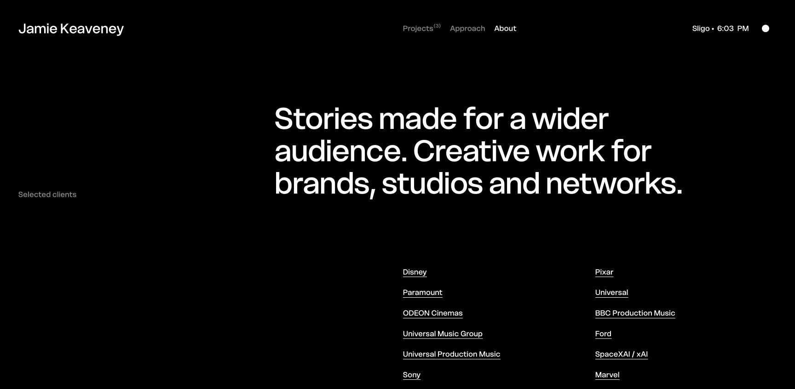
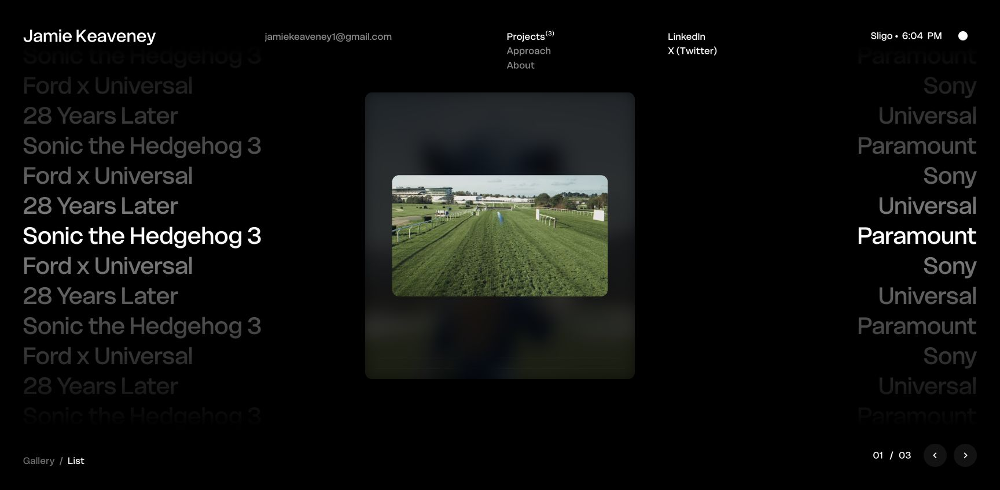

# Release validation — v1.3.1

Checked 23 November 2026 on [Webflow staging](https://jamiekeaveneyportfolio.webflow.io/).

Runtime CSS and JavaScript: `4939ec255b83d01558a7b371e679aa5b8959a100`. Both saved Webflow snippets point to this exact immutable commit. The final native Footer Grid variant was included in the last staging publish. Custom domains were not published.

## Automated checks

`npm run check`, `npm run build` and `git diff --check` pass. The build contains 35 JavaScript modules and eight stylesheets.

The checks exercise actual feature modules for shared scroll-motion bounds, title visibility during its flight, compact/touch parallax routing, list video cloning and playback ownership. Existing checks also cover sticky continuity, calendar rollover, footer geometry and navigation freeze, gallery looping, touch-player interactions, Services remount/breakpoint recovery and 404 gameplay.

The motion fixtures verify that both scroll-media features use the shared settings, that detached title words follow partial navigation opacity during a flight, and that compact/touch navigation bypasses media handoff while desktop retains it.

## Native Designer

All ten page trees and 35 shared component definitions were structurally inspected. Seven pages contain designed layouts; the Clients, Services and Project Media CMS templates have empty bodies.

| Populated page | Desktop canvas | Compact canvas |
| --- | --- | --- |
| Home | Hero, introduction, Services and Clients geometry checked | 393px stacking; 820px tablet four-column grid checked |
| Projects | Gallery cards, valid caption transition, controls and separator gaps checked | 393px stacked cards checked |
| Approach | First section starts column 3; Questions starts column 5 with bottom label | 393px full-width labels and headings checked |
| About | First section, Selected clients alignment and Selected work colours checked | 393px stacked editorial and client layout checked |
| Projects Template | 28 Years Later hero, media and details columns checked | 393px full-width hero and flex-column case layout checked |
| Password | Form fits its desktop canvas | Form fits 393px canvas |
| 404 | Full desktop composition checked | Two-column 393px layout checked |

The broken Designer helper rule produced 23 tracks from a twelve-column variable repeat. After the native repair, the same Home introduction grid resolved to 12 tracks and its heading widened from approximately 480px to 865px at a 1103px canvas width.

No published runtime was needed to correct that native geometry. Final desktop Designer review was left open at a normal browser width.

## Published desktop checks

Chrome at 1728 × 848:

- Navigation email hover displayed one Click to copy email instruction. Clicking displayed one Copied to clipboard! message with no stacked labels. Leaving reset the resting state.
- Footer email displayed a single copied message inside its 20.8px-high mask; the accessible label changed to Email copied to clipboard. The tool's separate clipboard buffer was not used as proof of the operating-system clipboard value.
- The list hover frame measured 373.023 × 209.820px, matching 16:9 to rounding. The active video was playing, while leaving the preview paused the videos. Pointer motion no longer kicks, rotates or displaces the preview.
- Clicking the hovered list preview created the desktop media-transition stage and landed on Sonic the Hedgehog 3. The stage was removed on completion. Gallery-to-project media transition was also checked.
- Projects caption CSS contains valid one-second top and left transitions. Gallery/List text and parent hit areas match after scoping out the navigation rollover.
- Fast scrolling through Sonic while the title was still represented by detached fixed word spans produced opacity zero on both the travelling words and case navigation. Scrolling back restored navigation visibility.
- Toolbar/count and breadcrumb/count gaps resolved to the same 8px at this viewport width.
- About Selected clients label and heading both ended at y=434.398px. The heading began at x=597.328px, column five relative to the 40px page margin.
- Selected work label resolved to rgb(138,138,138); campaign copy resolved to rgb(255,255,255).
- Home showreel and About portrait both used the shared 43.75rem perspective transform during scrolling. Source/fixture checks verify their common 32-degree ceiling, .015 velocity gain, .6 pitch ratio, response 10 and .18 scrub.
- Back to top used the existing shared SVG path at 1em with -90-degree rotation and returned the page to scroll position zero. Grid remained text-only through its separate native variant.
- No browser console errors were reported in the final staging check.

## Published compact checks

Chrome responsive viewport at 390 × 844:

- Home-to-Sonic entry showed the ordinary outgoing/incoming page translations during navigation, with no media-transition stage. Landing completed with one case container and no stuck transition flag.
- Browser Back from the case showed the standard page-parallax return and settled at Home scroll position zero.
- Projects-to-Ford navigation completed, and browser Back returned to Projects at the top with its normal compact layout.
- Home, Projects, Approach, About and the visited case pages had a 390px body width, without horizontal document overflow.
- Approach's first section and Questions label/heading all started at x=24px and filled approximately 342px, confirming the intended stacked compact layout.
- The About hero and navigation were visually checked at the compact width.

Temporary responsive sizing was cleared for the final staging view. The final staging and Designer review both used a 1728px-wide browser. These were browser responsive checks; physical iPhone/iPad gestures and Safari rendering were not tested in this pass.

## Release boundary

This release repairs the existing Webflow project and its shared runtime. The reference Lumos clone is unchanged. Staging is the reviewed publication target. Native implementation details are summarized in [webflow/LUMOS_REPAIRS.md](webflow/LUMOS_REPAIRS.md).
