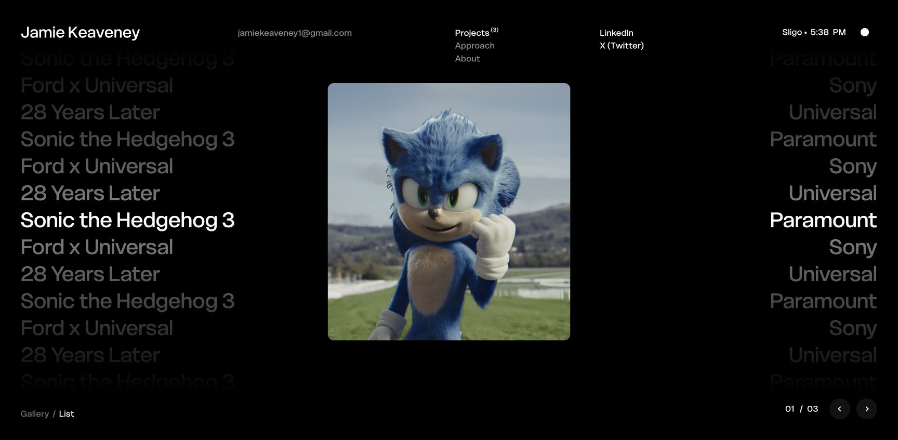

# Release validation — v1.2.6 / R17

Checked 19 November 2026 on Webflow staging. Runtime: `daee9312249bf786a24177644bb40e4f7cc36377`. Custom domains were not published.

## Automated checks

`npm run check` and `npm run build` pass. Build includes 29 scripts and 9 stylesheets.

Checks execute the actual modules for sticky curve continuity, calendar rollover, footer overlap/resize/freeze, gallery loop continuity, touch-player recovery/dismissal, and list playback ownership. The footer fixture now also verifies that the loader's page transform cannot advance footer parallax. New list checks verify no idle autoplay, hover playback, pointer-exit pause, drag suppression and hidden-tab pause. The 404 fixture verifies full-edge glyph bounds, weight 600, visible ball size, faster opening speed, successive paddle hits and absence of a canvas score behind the nav.

## Published browser verification

Chrome desktop at 1728 × 848:

- Gallery and list frames both measure width 466.28125px, height 496px, top 160px. This also holds after a direct list reload.
- List videos are all paused at rest. Hover starts only the active video; leaving pauses all videos.
- Loader samples show an 8px white bar, then a 1px white border at the viewport bottom, then the border moving upwards before removal. No Welcome panel is present.
- Footer refresh retains the exact 250.313px marquee top before and after the loader. During the page pull, internal footer transform remains -0.429px, avoiding the previous second movement.
- About Selected clients eases from 194.165px to its 192px sticky line. Selected work eases from 209.188px to 192.263px as the previous label releases.
- Services media is registered with the smooth-sticky engine. Its label and media share displacement and settle at approximately 159.76px / 332.56px, preserving their designed spacing.
- Light Services inactive labels compute to rgb(170,170,170), Work year to rgb(153,153,153), and shared secondary text token to #808080.
- About portrait uses the visible inner 3D perspective transform, with no planar rotation. Client-list margin computes to 48px.
- The project header is visible after loader completion and its page transform is cleared.
- 404 court bounds are the entire viewport. Play Pong starts the game and the score appears in the bottom layout.
- No browser console errors reported on the final Projects preview.

At 390 × 844, the 404 court fills the viewport, with a clear Page not found heading, Back to home link, Play Pong button and separate instructions; controls remain within the viewport. Viewport override reset after testing. Physical touch-device feel was not tested.

## Scope preservation

Desktop lightbox, mobile lightbox module, uniform gallery track motion and opposing list-label movement were retained. Native client spacing and 404 heading/button styles were updated in Webflow.

